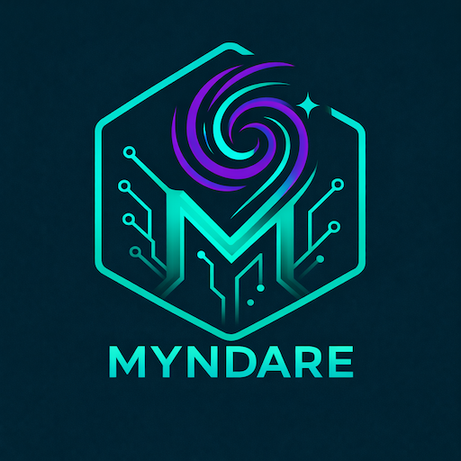
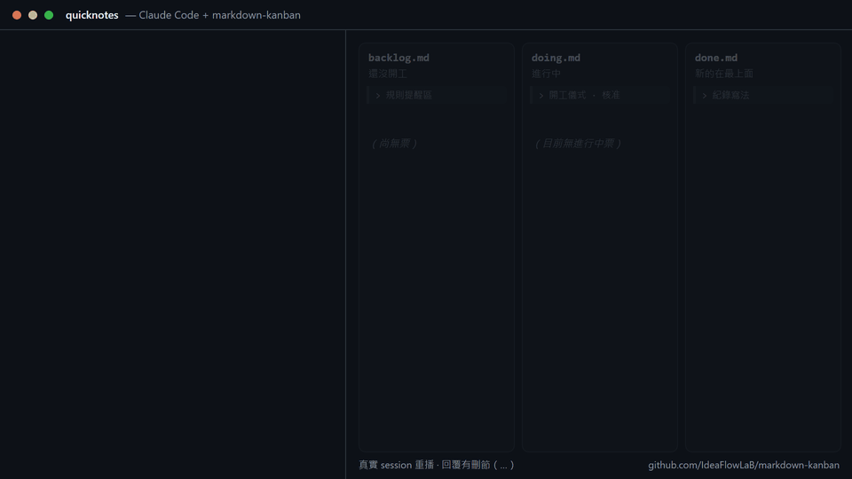
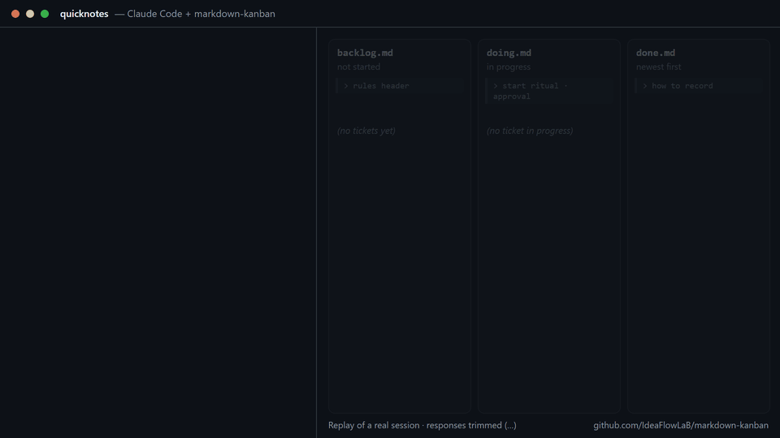

<div align="center">



# markdown-kanban

**給 coding agent 用的看板：三個 Markdown 檔，跟著程式碼一起進版。**<br>
<sub>A kanban board for coding agents — three Markdown files, versioned with your code.</sub>

[](https://github.com/IdeaFlowLaB/markdown-kanban/tags)
[](LICENSE)


[安裝 Install](#安裝--install) · [使用 Use](#使用--use) · [看板 Board](#看板長什麼樣子--what-the-board-looks-like) · [規則 Rules](#一頁看完規則--rules-in-one-screen) · [測試 Evals](#測試--evals)

</div>

<br>

<p align="center"></p>

<p align="center"><sub>真實 session 重播（回覆有刪節）</sub></p>

<details>
<summary><b>English demo</b></summary>
<br>
<p align="center"></p>
<p align="center"><sub>Replay of a real session (responses trimmed)</sub></p>
</details>

```
kanban/
├── backlog.md   還沒開工的票，依階段分區     · unstarted tickets, by phase
├── doing.md     真正在做的票＋開工儀式       · what is in progress + the start ritual
└── done.md      完工紀錄，新的在最上面       · finished work, newest first
```

看板本身就是 repo 裡的三個檔，跟它描述的工作在同一個 commit 進版。這個 skill 附上讓看板保持誠實的衛生規則：不管的話，agent（和人）都會讓看板慢慢走樣，完工的票被劃刪除線而不是移走、「✅ 已移入 done.md」的註記越積越多、開工的票還留在 backlog，下一個 session 還會把這些殘留當成慣例照抄。

> The board is three files in your repo, committed together with the work they describe. This skill adds the hygiene rules that keep it honest: left alone, agents (and people) drift — tickets get struck through instead of moved, "✅ moved to done.md" notes pile up, started tickets stay in the backlog, and the next session copies the mess as if it were the convention.

## 安裝 · Install

**Claude Code**（plugin marketplace）

```
/plugin marketplace add IdeaFlowLaB/markdown-kanban
/plugin install markdown-kanban@markdown-kanban
```

**其他 agent**（Cursor、Codex 等，透過 [skills](https://github.com/vercel-labs/skills)）

> **Other agents** (Cursor, Codex, … via skills)

```
npx skills add IdeaFlowLaB/markdown-kanban
```

**手動安裝**：把 `skills/markdown-kanban/` 複製到 `~/.claude/skills/`（或專案內的 `.claude/skills/`）。

> **Manual**: copy `skills/markdown-kanban/` into `~/.claude/skills/` (or your project's `.claude/skills/`).

### 更新 · Update

裝好之後**不會自動更新**。Claude Code 預設只自動更新官方 marketplace，第三方的要自己打開。

> Installed copies **do not update on their own**. Claude Code auto-updates only official marketplaces by default; third-party ones are opt-in.

**Claude Code**：建議在 `/plugin` 的 **Marketplaces** 分頁替 `markdown-kanban` 打開自動更新。要手動更新的話：

> **Claude Code**: turn on auto-update for `markdown-kanban` in the **Marketplaces** tab of `/plugin` (recommended), or update by hand:

```
/plugin marketplace update markdown-kanban
/plugin update markdown-kanban@markdown-kanban
```

更新後重開 Claude Code 才會生效。

> Restart Claude Code to apply the update.

**其他 agent**：

> **Other agents**:

```
npx skills check     # 查有沒有新版 · check for updates
npx skills update    # 更新 · update
```

**手動安裝**：重新複製一次 `skills/markdown-kanban/`。

> **Manual**: copy `skills/markdown-kanban/` again.

## 使用 · Use

在任何專案裡說「**幫這個專案建一個看板**」。

> In any project, say "**Set up a kanban board for this project.**"

會建好 `kanban/` 三個檔，並在 agent 的指令檔加一小段看板掛鉤：Claude Code 是 `CLAUDE.md`，Codex、Cursor 等是 `AGENTS.md`，兩個都有就兩個都加。之後每個 session 開工前都會先讀 `doing.md`。如果你的 agent 兩個檔都不讀，請把[這段掛鉤](skills/markdown-kanban/templates/claude-md-snippet.md)貼進它的專案規則。

> This creates the three files in `kanban/` and appends a short Kanban section to your agent instruction file — `CLAUDE.md` for Claude Code, `AGENTS.md` for Codex, Cursor and others (both, if both exist) — so every future session reads `doing.md` first. If your agent reads neither, paste [the snippet](skills/markdown-kanban/templates/claude-md-snippet.md) into its project rules.

之後照平常講話就好：

> From then on, talk normally:

| 你說 · You say | 看板會 · The board |
|---|---|
| 「開一張票：PDF 匯出。」<br><sub>"Add a ticket for PDF export."</sub> | 在 `backlog.md` 對應的階段底下開票<br><sub>a ticket in `backlog.md`, under its phase</sub> |
| 「我們要做筆記分享：分享連結、權限、撤銷畫面。」<br><sub>"We need note sharing with links, permissions and a revoke screen."</sub> | 一張母票拆成可以各自實作、驗證的子票 `[APP-7a]`、`[APP-7b]`……，母票另寫一條**整合**檢查<br><sub>a parent split into sub-tickets that can each be built and verified, plus an **Integration** check</sub> |
| 「筆記要能離線編輯，但我還不知道衝突要怎麼處理。」<br><sub>"Notes should work offline, but I don't know how conflicts should work."</sub> | 先開一張 🌩️ 風暴單列出待決問題，跟你談定之後才拆票<br><sub>one 🌩️ storm ticket with open questions, settled with you before any split</sub> |
| 「開始做 APP-7a。」<br><sub>"Start APP-7a."</sub> | 開工：剪到 `doing.md`，走開工儀式：查證 → 計畫 →（核准）→ 實作<br><sub>started: cut into `doing.md`, then verify → plan → (approval) → build</sub> |
| 「APP-7a 做完了，測試全過。」<br><sub>"APP-7a is done, tests pass."</sub> | 剪到 `done.md` 最上方，寫明做了什麼、怎麼驗證<br><sub>cut into `done.md` (newest first) with what shipped and how it was verified</sub> |

看板語言跟著你的專案走，票用什麼語言寫都可以。

> The board's language follows your project — write tickets in any language.

## 看板長什麼樣子 · What the board looks like

每個看板檔最上方都帶著自己的規則，不管是人，還是沒載入這個 skill 的 agent，打開就看得懂。

> Every board file starts with its own rules, so anyone who opens it — a person, or an agent that never loaded this skill — sees how the board works.

### `backlog.md`

依**階段**分區（最上面有一張階段出口條件表），之後是「等外部」、「下一波」（已表態要做、還沒拆票）、「後備」（附上重新排程的觸發條件）。提醒區還有**共同驗收**：每張票都要過的條件，由你自己填。

> Grouped into **phases** (with a table of exit conditions), then *Waiting on others*, *Next wave* (agreed, not yet split) and *Parked* (with the trigger that would bring it back). The header also holds your **common acceptance** criteria that every ticket must meet.

### `doing.md`

每張票都走**開工儀式**：移入 → 查證程式碼跟票文還對得上 → 寫計畫 → 核准 → 實作。哪些票在實作前要你核准，是一行可以直接改的設定：

> Every ticket goes through the **start ritual**: move → verify the code still matches the ticket → plan → approval → build. Which tickets need your approval before coding is one line you can edit:

```
> **Approval before coding**: medium, large, storm
> (options: `all` | `medium, large, storm` | `storm only`)
```

預設下，小而明確的票（錯字、一行修正）會直接動手做。

> Under the default, small, obvious tickets (a typo, a one-line fix) go straight to building.

### `done.md`

新的放最上面，一張票一條：**形狀／為何／裁決／執行紀錄／驗證**。歷史全部保留，但 agent 只讀檔頭和最新幾筆，其餘用票號搜尋，歷史再長也不會吃光 context。

> Newest first, one entry per ticket: **Shape / Why / Decisions / Log / Verification**. It keeps everything, but agents read only its header and newest entries and search the rest by ticket ID, so a long history does not eat the context window.

## 一頁看完規則 · Rules in one screen

- **每張票只存在一個檔裡，而且是完整的一整條。** 移動就是整條剪走，不複製、不劃刪除線。
- `doing.md` 只放真正在做的票；沒有就寫「（目前無進行中票）」。
- `backlog.md` 只放還沒開工的票。
- `done.md` 是決策史：**形狀／為何／裁決／執行紀錄／驗證**，新的放最上面。
- 母票要等**整合**檢查通過才結案，不是子票全過就算完成。
- `done.md` 預設不整份讀，舊紀錄不改寫、不重新摘要。省 context 只省在讀取，記錄時不省。
- 看板上已經存在的殘留是要清掉的違規，不是可以照抄的慣例。

> - **Every ticket lives in exactly one file, in full.** Moving = cutting the whole entry, never copying or striking through.
> - `doing.md` holds only what is truly in progress; empty means `(no ticket in progress)`.
> - `backlog.md` holds only unstarted tickets.
> - `done.md` is the decision history: **Shape / Why / Decisions / Log / Verification**, newest on top.
> - A parent ticket closes only when its **Integration** check passes, not just because every sub-ticket did.
> - `done.md` is never read whole by default, and old entries are never rewritten or re-summarized. Saving context applies to reading, never to what gets recorded.
> - Leftovers already on the board are violations to clean up, not a convention to copy.

## 進階慣例 · Advanced conventions

完整說明見 [`references/conventions.md`](skills/markdown-kanban/references/conventions.md)。

> Full details in [`references/conventions.md`](skills/markdown-kanban/references/conventions.md).

### 🌩️ 風暴單 · Storm tickets

寫票當下還不知道正解的工作：跨越多張票累積出來的結構性問題，或需求、做法還沒定案的大需求。一般票是「照票文做」，風暴單是「照票文想」：

1. **記下**：開一張票列出待決問題，狀態 `discovery`（探索中）。
2. **談定**：逐題跟負責人談，答案記成 📌 註記；全部答完改成 `ready`（可拆票）。
3. **重審**：現況有沒有漂移、根因判斷是否仍成立（新需求則改問背後真正的需求與前提假設）、有沒有更好的解法、有沒有新的地雷。
4. **拆票**：拆成一般票，母票寫上整合檢查。

這些都在 `backlog.md` 進行。你說「開始做」才算開工，這時才移進 `doing.md`。如果還在 `discovery` 你就說開始，agent 會先問完待決問題，不會自己替你選答案；你要它照預設做，它會把每個預設記成你同意的假設。拆出來的子票可以同時進行，只有 **Depends on** 寫到的票要等。

> Work whose right answer is not known when it is written: a structural problem that built up across many tickets, or a large request whose requirements or approach are not settled. A normal ticket is executed as written; a storm ticket is *thought through* as written:
>
> 1. **Capture** — one ticket with the open questions, **Status** `discovery`.
> 2. **Settle** — answer them with the owner, each recorded as a 📌 annotation; when all are answered, `ready`.
> 3. **Re-review** — drift, root cause (or, for a new request, the underlying need and assumptions), better fixes, new landmines.
> 4. **Split** — into normal tickets, with an integration check on the parent.
>
> All of this happens in `backlog.md`. It moves into `doing.md` only when you start it. If you say start while it is still `discovery`, the agent first asks the open questions instead of answering them itself; if you tell it to use its defaults, each one is recorded as an assumption you accepted. Its sub-tickets can be in progress at the same time; only what is named in **Depends on** makes one wait.

### ⛔ 停工 · Blocked

票留在 `doing.md`，寫明在等誰、等什麼決定。

> Stays in `doing.md`, says who or what it waits on.

### 📌 加註 · Annotations

拆票、升格、改範圍時加上日期註記，不改寫原文。

> Splits and rescopes are added as dated notes instead of rewriting the original ticket.

## 測試 · Evals

skill 附一套 [`claude plugin eval`](evals/) 測試，每個情境都分「有 skill」和「沒 skill」兩組跑。分數是多次執行的結果；沒 skill 那組每次會浮動。

> The skill ships with a [`claude plugin eval`](evals/) suite that runs each scenario with and without the skill. Scores span several runs; the no-skill baseline varies run to run.

| 案例 · Case | 情境 · Scenario | 沒 skill<br><sub>Without</sub> | 有 skill<br><sub>With</sub> |
|---|---|:-:|:-:|
| `finish-ticket` | 完工剪票<br><sub>finish a ticket</sub> | 0.60–0.80 | 1.00 |
| `mark-done-messy` | 看板本來就有殘留<br><sub>board already has leftovers</sub> | 0.17–0.33 | 1.00 |
| `init-board` | 建看板：三檔、提醒區、階段、核准設定<br><sub>files, rules headers, phases, approval line</sub> | 0.11–0.20 | 1.00 |
| `init-board-agents-md` | 掛鉤也寫進 AGENTS.md<br><sub>hook also lands in `AGENTS.md`</sub> | 0.33 | 1.00 |
| `split-large-request` | 大需求拆子票＋整合欄位<br><sub>sub-tickets + integration field</sub> | 0.20 | 1.00 |
| `finish-last-subticket` | 母票等整合檢查才結案<br><sub>parent waits for its integration check</sub> | 0.00 | 1.00 |
| `storm-uncertain-request` | 需求不明 → 風暴單＋提問<br><sub>unclear request → storm ticket + questions</sub> | 0.33–0.67 | 1.00 |
| `storm-resume-discovery` | 新 session 接手：只問還沒答的<br><sub>new session asks only what is still open</sub> | 1.00 | 1.00 |
| `storm-ready-to-split` | 在 backlog 拆票＋整合欄位<br><sub>split in backlog, with integration</sub> | 0.40 | 1.00 |
| `start-storm-ticket` | 開工風暴單<br><sub>start a storm ticket</sub> | 0.60–1.00 | 1.00 |
| `start-discovery-storm` | 還在探索就說開工：先問待決問題<br><sub>start while in discovery: ask the open questions first</sub> | 0.33–1.00 | 1.00 |
| `start-concurrent-subticket` | 子票可同時進行<br><sub>sub-tickets can run at the same time</sub> | 1.00 | 1.00 |
| `start-medium-ticket` | 中型票：查證、計畫、停下等核准<br><sub>verify, plan, stop for approval</sub> | 0.40 | 1.00 |
| `start-small-ticket` | 小票直接修<br><sub>just fix it</sub> | 1.00 | 1.00 |
| `approval-all-policy` | 改過的核准設定有被遵守<br><sub>edited policy is obeyed</sub> | 1.00 | 1.00 |
| `finish-long-history` | 2,800 行的 done.md：只讀開頭<br><sub>read only the top of a 2,800-line `done.md`</sub> | 0.67 | 1.00 |
| `finish-rich-record` | done 保留決策脈絡<br><sub>decision context kept in `done.md`</sub> | 0.00 | 1.00 |
| `new-request` | 新需求開票<br><sub>new request</sub> | 1.00 | 1.00 |
| `new-request-phase` | 新需求放進對的階段<br><sub>new request lands in the right phase</sub> | 1.00 | 1.00 |

自己跑：

> Run it yourself:

```
claude plugin eval . --scaffold --allow-tools Write Edit
```

## 授權 · License

[MIT](LICENSE) © IdeaFlowLaB
